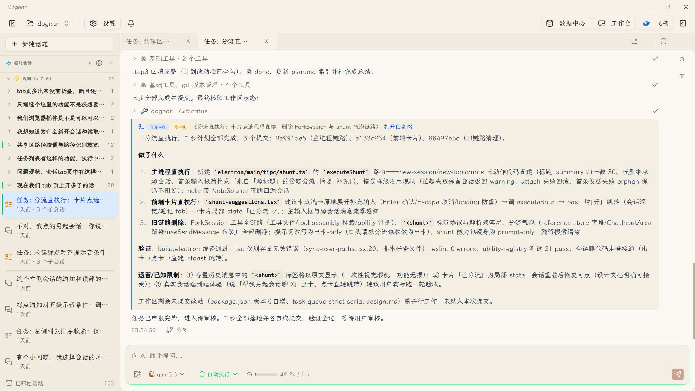
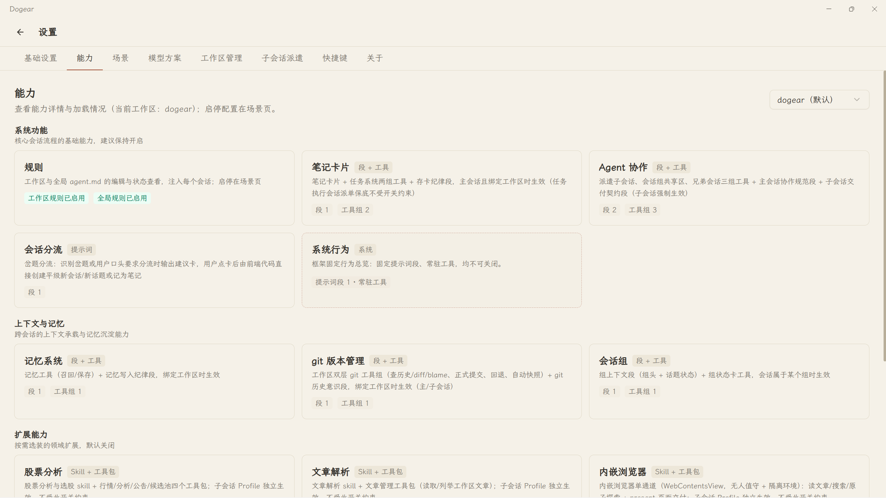

<div align="center">


# Dogear

**AI 驱动的个人工作台** —— 多 Agent 协作 · 软件开发 · 浏览器扩展

[](./LICENSE)
-lightgrey)


</div>

---

## ✨ 这是什么

Dogear 是一个本地优先的 AI 工作台，围绕三件事深入打磨：**多 Agent 协作**（主会话派遣子会话干活、验收交付、失败自动续跑）、**软件开发与实施**（计划 → 排队 → 执行 → 审核的任务流水线，工作区与 git 深度集成）、**浏览器协作**（受控内嵌浏览器 + 扩展通道实时操作网页）。文章阅读与股票分析作为可选能力内置。

Dogear 本身就是用 Dogear 开发的——从设计文档到分步实施再到验收提交，全程在这套协作系统里完成。

### 核心能力

- 🤖 **多 Agent 协作** — 主会话按成本判断派遣子会话（探索 / 实施 / 浏览器解析等 Profile），双向通信、交付验收、失败自动续跑；协作任务走「计划 → 排队 → 执行 → 审核」流水线
- 💻 **软件开发与实施** — 多工作区隔离；git 双层工具（正式提交历史 + 影子快照安全网）；任务执行会话按计划文档形态（单文档设计 / 分步 stepN）自动挂载工程纪律 Skill，分步计划逐步派子会话实施、逐步提交
- 🌐 **浏览器与扩展通道** — 受控内嵌浏览器（代理 / 站点策略 / 网银域名拦截）+ 浏览器扩展实时协作通道 + 网页 AI 站点切换器，登录态站点调研自动等待人工
- 🧠 **记忆与笔记** — 跨会话主题记忆、工作区笔记卡片、话题状态自动提炼，长周期工作不丢上下文
- 🔧 **能力包配置体系** — 13 个能力包 × 主会话 / 子会话 / 任务执行 / 定时任务等 7 类场景的挂载矩阵，每个场景启用哪些工具与 Skill 全部可视化开关
- 🔑 **多厂商模型** — 应用内配置 Profile（Anthropic / OpenAI 兼容端点 / GLM / DeepSeek 等），主模型、解析、视觉、摘要分场景选型，自动 failover
- ⏰ **定时任务** — 8 种触发器（每日/每月指定时刻、间隔、时间窗、一次性、应用启动、窗口关闭、会话关闭），按计划自动执行自定义 Agent 任务，可挂载能力与 Skill
- 🔄 **跨设备同步与备份** — 局域网设备发现与配对，会话、笔记、记忆在设备间直接同步，无需云端；应用数据分类自动备份 + 影子快照安全网
- 📚 **文章阅读库（可选）** — epub / PDF / 网页导入，正文自动提取为 Markdown，AI 辅助阅读
- 📈 **股票分析（实验性 · 可选）** — A 股数据（akshare / baostock）+ 指标计算、选股、回测。⚠️ 功能尚在完善中，数据与计算结果仅供学习研究，**不构成任何投资建议**

<div align="center">
  
  
</div>

## 🚀 快速开始

### 前置依赖

| 依赖 | 版本 | 说明 |
|------|------|------|
| [Bun](https://bun.sh) | ≥ 1.0 | 包管理与运行时 |
| [Python](https://www.python.org/) | ≥ 3.10 | 股票计算层 |
| Git | — | 克隆仓库 |

安装 Python 依赖（**可选**，仅股票分析等实验性功能需要，跳过不影响其他功能）：

```bash
python -m pip install -r python/requirements.txt
```

### 运行

```bash
git clone https://github.com/DreamFate/dogear.git
cd dogear
bun install
bun run dev
```

首次启动后进入 **设置 → 模型方案**，添加你的模型 Profile（填入 API Key 与 Base URL 即可，支持多厂商与 OpenAI 兼容端点），无需任何环境变量或配置文件。

### 构建打包

```bash
bun run dist
```

支持 Windows（NSIS 安装包）与 macOS（Apple Silicon / M1 及以上，DMG）。macOS 版未做 Developer ID 签名公证，首次打开如被 Gatekeeper 拦截，右键应用选「打开」即可。

## 🔌 可选集成

- **飞书 Bot** — 在应用内绑定飞书开放平台应用后，可通过飞书对话使用 Dogear（设置页有配置引导）
- **浏览器扩展** — 配合扩展通道实现浏览器实时协作，受控浏览器小节有一键安装引导

## 🤝 贡献

欢迎 Issue 与 PR。入手请从 [docs/codebase-map/index.md](./docs/codebase-map/index.md) 开始——这是按功能域划分的完整代码地图，标注了每个模块的文件路径与注意事项。

> 提交 PR 即表示你同意以 **AGPL-3.0** 及版权人后续指定的其他协议授权你的贡献。

## 📄 License

本项目基于 [AGPL-3.0](./LICENSE) 协议开源。

Copyright (C) 2026 Dreama
